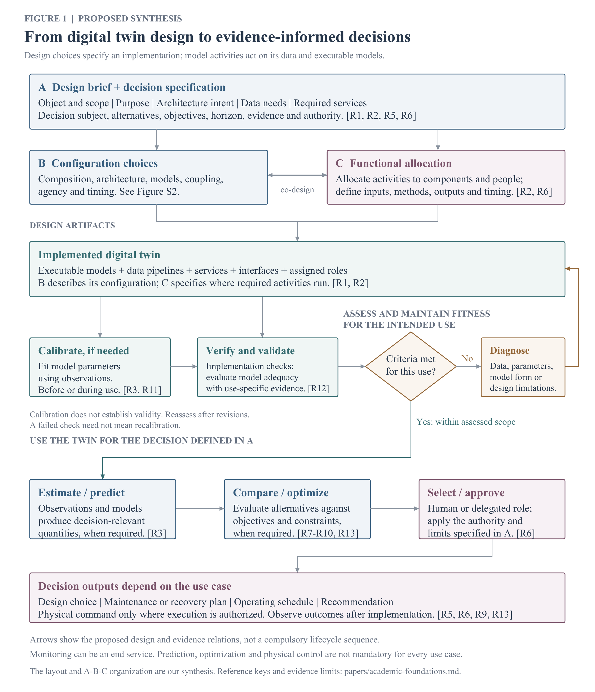
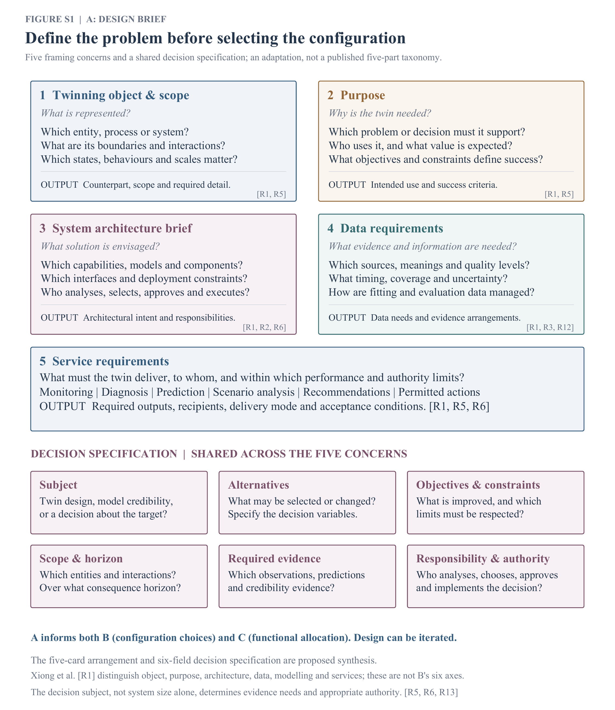
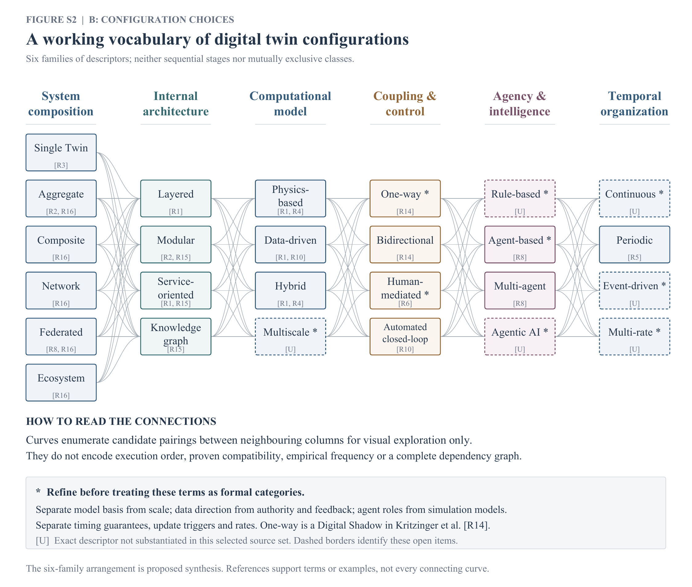
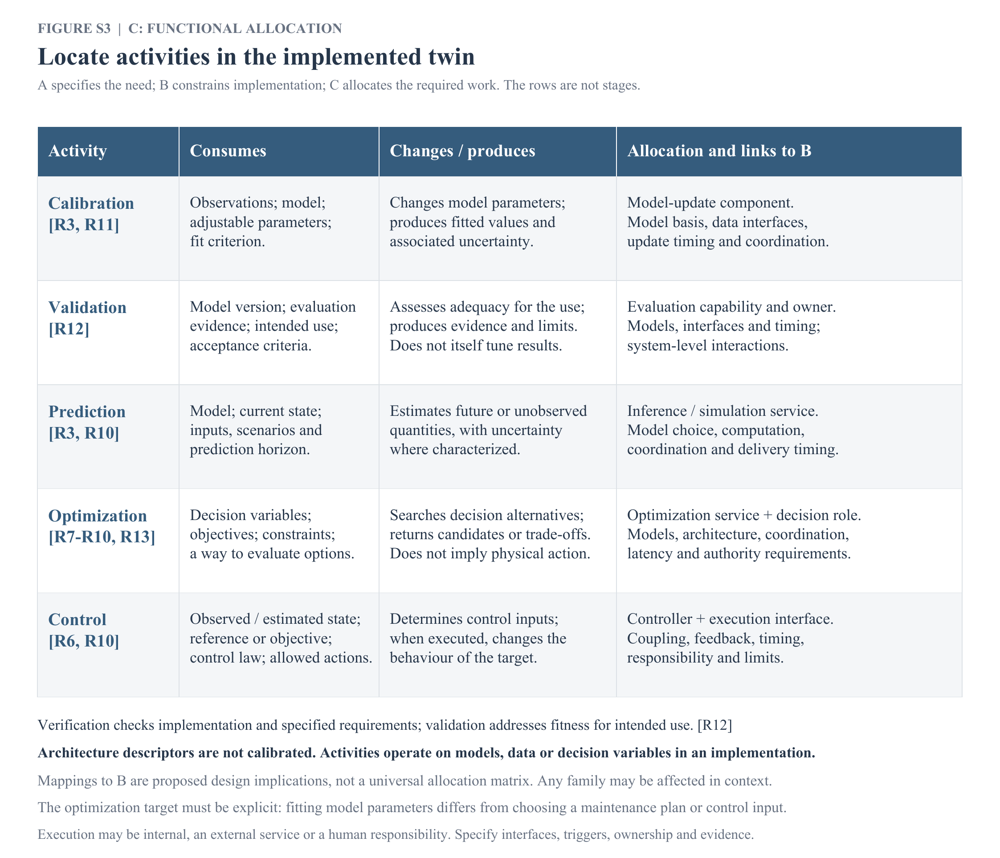

# Digital twin design and configuration

**Current version: 2026-10-31.** This package replaces the earlier 4+6 view as the current working proposal. It separates the design brief (A), configuration choices (B), functional allocation (C), and the implemented twin on which model activities operate.

**Scientific status:** literature-informed synthesis for manuscript development. The drawing and A-B-C organization are our proposal; they are not a published universal taxonomy or an ISO-endorsed framework. Source keys are printed on the figures. Open evidence gaps remain visibly marked in Figure S2 and in the configuration audit.

## Main figure

[Vector PDF](figures/figure_1_design_to_use.pdf) · [Editable SVG](figures/figure_1_design_to_use.svg)

**Figure 1.** Proposed relation between DT design and use. The brief defines intended use, decision scope, evidence and authority. Configuration and functional allocation jointly inform implementation. Calibration, verification and validation concern instantiated models, data and software. The criteria gate is use-specific; diagnosis can lead to changes beyond parameter fitting. The analysis/selection path is illustrative and optional: services may stop at monitoring or prediction. Decisions can yield designs, plans, recommendations or permitted commands. The arrangement is synthesized from the sources, not reproduced from one paper.

## Supplement A — Design brief

[Vector PDF](figures/figure_S1_design_brief.pdf) · [Editable SVG](figures/figure_S1_design_brief.svg)

**Figure S1.** Five framing concerns and six cross-cutting decision questions proposed for this review. They distinguish the decision subject, alternatives, objectives, scope/horizon, evidence and responsibility. The five-card grouping adapts literature on requirements and cross-domain characterization; it is not Xiong et al.'s exact six-dimensional framework.

## Supplement B — Configuration vocabulary

[Vector PDF](figures/figure_S2_configuration_choices.pdf) · [Editable SVG](figures/figure_S2_configuration_choices.svg)

**Figure S2.** Six working families retain the earlier network style. Options may coexist; columns are not lifecycle steps. Curves enumerate candidate pairings between neighbouring columns for exploration and do not establish compatibility. Asterisks identify terms needing refinement; dashed boxes and U identify evidence gaps in the selected set. This figure is an audited working vocabulary, not a finalized taxonomy. For an article claiming a formal taxonomy, resolve these items first.

## Supplement C — Functional allocation

[Vector PDF](figures/figure_S3_functional_allocation.pdf) · [Editable SVG](figures/figure_S3_functional_allocation.svg)

**Figure S3.** Inputs, effects and proposed architectural implications of calibration, validation, prediction, optimization and control. C assigns work to components and roles; it is not a separate execution layer. All B families can be affected in context, but no universal influence matrix is asserted. Calibration acts on model parameters; optimization requires explicit decision variables; control additionally needs an execution interface and authority.

## Academic foundations and editable material

- [Academic foundations, sixteen source records, DOIs and evidence boundaries](papers/academic-foundations.md)
- [Descriptor-by-descriptor configuration audit](papers/configuration-audit.csv)
- [BibTeX reference file](papers/references.bib)
- [Reproducible drawing source](source/build_figures.py)

PDFs contain embedded Times New Roman fonts. SVGs retain editable text with serif fallbacks. PNGs are rendered from the PDFs at 300 dpi. Figures use a 190 mm publication width; resizing requires a fresh legibility check. The scripts require Python, ReportLab and suitable Times font files; see the source README.

## Previous versions

The earlier [six-column PNG](figures/dt-6d-configuration-network.png) and [4+6 SVG](figures/dt-structure-4-plus-6.svg) are retained for history. They should not be mistaken for the current figures. The [earlier conceptual note](archive/README-4-plus-6.md) and [earlier source register](papers/README.md) remain available. The current source register above uses R1-R16, which are local to this package.

No new research-data findings are claimed by these illustrations. They are design and review artifacts whose concepts, limits and proposed contributions are explicitly distinguished.
