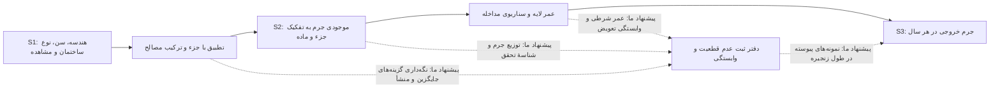

# غربالگری اتصال‌های S1→S2 و S2→S3

تاریخ: ۱ نوامبر ۲۰۲۶. مجموعهٔ ورودی: همان ۴۳ رکورد یکتای جست‌وجوی سه پایگاه؛ هیچ مقالهٔ جدیدی به شمارش اضافه نشده است.

## نتیجهٔ غربالگری

| تصمیم | تعداد | معنی |
|---|---:|---|
| نگه‌داری در هستهٔ موضوع | ۸ | تبدیل اطلاعات ساختمان به موجودی یا اتصال موجودی به عمر/جریان؛ بعضی هنوز مفهومی‌اند |
| نگه‌داری به‌عنوان مکمل | ۶ | تشخیص مواد، کنترل کیفیت داده، لجستیک یا شبیه‌سازی زمانی؛ دامنه دقیق در جدول مشخص است |
| پیشینه | ۱۸ | مرور، مفهوم‌پردازی و پذیرش فناوری؛ شاهد مستقیم اجرای اتصال محسوب نمی‌شوند |
| حذف از سنتز این دو اتصال | ۱۱ | خارج از دامنه یا رکورد کل مجموعه‌مقالات؛ دلیل اختصاصی هر مورد ثبت شده است |

این تصمیم‌ها غربالگری یک ارزیاب با کمک هوش مصنوعی‌اند؛ توافق بین دو ارزیاب یا مرور نظام‌مند نهایی ادعا نمی‌شود. نبود عبارت uncertainty معیار حذف نبود. «نگه‌داری» نیز به معنی اثبات انتقال عدم قطعیت نیست. جدول `screening_43.csv` همهٔ رکوردها، DOIهای موجود، چکیده و دلیل تصمیم را حفظ می‌کند.

## کدام مقاله‌ها به سؤال اصلی نزدیک‌ترند؟

| مقاله | نقش واقعی در اتصال | وضعیت و حد شواهد |
|---|---|---|
| Ettl و همکاران، Urban Mining Potentials، DOI: 10.1007/978-981-96-6657-7_7 | نزدیک‌ترین مسیر کامل S1→S2→S3: CityGML، ترکیب لایه‌ها، جرم، عمر خدمت و خروج سالانه | PDF دریافت شد؛ روش و محدودیت‌های فصل بررسی شد |
| Slavkovic و همکاران، Parametric archetypes، بدون DOI در خروجی‌ها | ساختار تو‌در‌توی ساختمان/اسمبلی/عنصر/ماده و تبدیل هندسه به جرم | PDF؛ مناسب S1→S2، قابلیت جریان پویا با اجرای واقعی پیش‌بینی زمانی یکسان نیست |
| Elshaboury و همکاران، BIM–GIS، DOI: 10.1016/j.jobe.2025.113391 | اسکن و مشخصات مصالح → شدت ماده → حجم GIS؛ مشاهدهٔ تخریب در چند تاریخ | متن کامل HTML؛ یک ساختمان اسکن شده، نه ۲۳ اسکن مستقل؛ تعمیم کامل منطقه اجرا نشده است |
| Jašek و Kubečková، مسکن چک، DOI: 10.1016/j.istruc.2025.109180 | برداشت ساختمان موجود → BIM طبقه/عنصر → موجودی اجزای قابل استفاده مجدد | متن کامل HTML؛ زمان خروج احتمالی محاسبه نشده است |
| BIM–stochastic simulation، DOI: 10.3390/buildings16153012 | روش مکمل برای قرارداد داده، تبدیل متغیر تصادفی و حلقهٔ بازنگری | HTML کامل؛ مثال مفهومی زمان‌بندی ساخت، نه مدل خروج مصالح از موجودی شهری |
| Gehring و Rüppel، logistics twin، DOI: 10.3389/fbuil.2023.1145250 | اتصال شناسهٔ جزء، محصول، بسته، محل و تاریخ | PDF؛ ردیابی لجستیکی مواد، بدون انتقال کمی عدم قطعیت |

برای ۱۴ مورد منتخب، `extraction_14.csv` ورودی، تبدیل، خروجی، منشأ عدم قطعیت، نحوهٔ نمایش، انتقال، ردیابی، اعتبارسنجی، محل شاهد و پیشنهاد تکمیلی ما را جدا می‌کند. مواردی که متن کاملشان هنوز در دست نیست با «تأییدنشده» ثبت شده‌اند، نه با استنباط از چکیده.

## ساختار قابل استخراج از شواهد

مسیر مشترک یک زنجیرهٔ تبدیل داده است:

فلش‌های پیوسته مسیر دادهٔ پشتیبانی‌شده در مقالات‌اند. فلش‌های نقطه‌چین، ترکیب پیشنهادی این مرور هستند؛ یک معماری یکپارچهٔ اعتبارسنجی‌شده در این مجموعه نیستند.

### اتصال S1→S2: عدم قطعیت چه تغییری می‌کند؟

در فصل Ettl، دادهٔ CityGML شامل نوع و سال ساختمان و مساحت اجزا است. از پایگاه ۱۱۳۴ ساختار جزء، گزینه‌های سازگار با سن، نوع ساخت و شرایط ساختمان فیلتر می‌شوند. جرم هر لایه با رابطهٔ زیر محاسبه می‌شود:

`m = A × d × ρ × α`

`A` مساحت، `d` ضخامت، `ρ` چگالی و `α` سهم ماده در لایهٔ مرکب است؛ سهم درصدی در پیاده‌سازی باید به کسر تبدیل شود. منبع: بخش 7.3.4 و معادلات 7.1–7.2 همان فصل.

اما مقاله برای گزینه‌های متفاوت ساخت، «جزء مصنوعی» با جرم میانگین می‌سازد. **این محل مشخصِ از دست رفتن پراکندگی است:** چند احتمال برای ترکیب ساختمان به یک مقدار میانگین تبدیل می‌شوند. مقاله جرم را منتقل می‌کند، ولی پراکندگی گزینه‌های ورودی را به‌صورت توزیع خروجی گزارش نمی‌کند. این تفسیر تحلیلی ما از عملیات میانگین‌گیری است، نه ادعای نویسندگان دربارهٔ اجرای UQ.

در BIM–GIS نیز حجم جزء و چگالی به جرم تبدیل می‌شوند؛ سپس جرم بر حجم ناخالص تقسیم می‌شود تا شدت ماده به دست آید و به حجم GIS نگاشت شود. مشاهدهٔ هندسه، حدس ترکیب پنهان و تعمیم یک ساختمان به ساختمان‌های دیگر سه منشأ متفاوت عدم قطعیت‌اند. اصلاح حجم با ضریب 1.01، جایگزین برآورد پراکندگی یا خطای تعمیم نیست. محدودیت‌های بخش ۷ شامل حذف پی، نبود آزمایش ترکیب مصالح و محدودیت نمونهٔ اسکن‌شده است.

**افزودهٔ پیشنهادی ما:** در خروجی S1 فقط یک هندسه یا برچسب ماده ذخیره نشود. برای هر جزء، منبع مشاهده، زمان برداشت، مشاهده‌شده/استنباط‌شده بودن، گزینه‌های ترکیب و مدل خطا ثبت شود. موتور تبدیل S1→S2 همین گزینه‌ها و پارامترهای وابسته را به جرم تبدیل کند. اگر احتمال گزینه‌ها معلوم نیست، سناریو/بازه گزارش شود؛ وزن احتمالی ساختگی داده نشود. خطای مشترک چگالی یا آرکی‌تایپ میان چند ساختمان مستقل فرض نشود.

### اتصال S2→S3: عدم قطعیت جرم به عدم قطعیت زمان و جریان تبدیل می‌شود

فصل Ettl جرم هر لایه را به عمر خدمت آن وصل می‌کند. خروجی CSV برای سال تعویض و گروه ماده ردیف جدا دارد و سپس جرم خروجی هر سال تجمیع می‌شود (7.3.5 و 7.4.1). این یک اتصال واقعی موجودی→جریان زمانی است.

بااین‌حال، عمرها مرجع و سناریوها قطعی‌اند. نویسندگان سه محدودیت صریح دارند (7.5.1): مداخلهٔ هم‌زمان در کل محله واقع‌بینانه نیست؛ وابستگی تعویض لایه‌ها کامل بازنمایی نشده؛ مقدار «≥۵۰ سال» عمر دقیق نیست. بنابراین مقاله برای محل اتصال بسیار مفید است، ولی انتقال احتمالاتیِ عدم قطعیت از مشاهده تا خروج سالانه را نشان نمی‌دهد.

**افزودهٔ پیشنهادی ما:** برای هر تحقق مشترک `r`، جرم `M[r]` از S2 حفظ شود و زمان خروج `T[r]` با توجه به سن فعلی، بقای جزء تا امروز، وضعیت و سناریوی مداخله تولید شود. برای یک خروج منفرد:

`F[t,r] = Σ_i M[i,r] × 1(T[i,r] در سال t)`

برای تعویض‌های تکرارشونده، باید شناسهٔ رویداد و جرم جایگزین جدید تعریف شود تا یک جرم موجود چندبار به‌عنوان همان خروج شمرده نشود. وابستگی لایه‌ها و مداخلات جمعی باید صریح باشد. این رابطه و قرارداد تحقق مشترک **پیشنهاد سنتز ما** هستند؛ به‌عنوان روش اجراشدهٔ فصل نقل نمی‌شوند.

### چه چیزی را می‌توان «ردیابی عدم قطعیت» نامید؟

شناسهٔ ماده و تاریخ برای ردیابی خود ماده کافی‌اند، اما برای ردیابی عدم قطعیت کافی نیستند. حداقل اطلاعات پیشنهادی در هر عبور عبارت‌اند از:

`asset_id, component_id, source_id, observation_time, model_version, transformation_id, input_uncertainty, dependence_group, scenario_id, realization_id, output_uncertainty`

این ثبت باید پاسخ دهد: کدام عدم قطعیت از مرحلهٔ قبل آمده؛ کدام در این تبدیل اضافه شده؛ کدام بر اثر میانگین‌گیری یا تجمیع حذف شده؛ و مشاهدهٔ جدید کدام خروجی‌ها را تغییر می‌دهد. پشتوانهٔ اجزای این پیشنهاد عبارت است از سلسله‌مراتب Slavkovic، شناسه‌ها و مدل رابطه‌ای Gehring، و قرارداد داده و حلقهٔ بازنگری مقالهٔ شبیه‌سازی. **ترکیب این اجزا در دفتر ثبت واحد عدم قطعیت، پیشنهاد این مرور است.**

## تمایزهایی که نتیجه را عوض می‌کنند

- تشخیص ۱۱ لوله از ۱۴ لوله و خطای مکانی میانگین 0.75 متر، ارزیابی عملکرد مشاهده است؛ هنوز توزیع عدم قطعیتِ موجودی جرم نیست. مقالهٔ اسکن لوله، بخش‌های ۳–۵.
- طبقه‌بندی صوتی مواد در IEEE روی سه جنس و یک شیء برای هر جنس ارزیابی شده است. دقت ۹۱٪ شرایط کنترل‌شده با رفتار حدود ۷۵٫۴٪ در آزمایش نویز محیط برابر نیست. این‌ها احتمال کالیبره‌شدهٔ جنس هر جزء ساختمانی نیستند. بخش‌های IV–V.
- مقالهٔ BIM–AI تصریح می‌کند استخراج NLP/CV با دادهٔ مرجع اعتبارسنجی کمی نشده است. دامنهٔ هزینهٔ پیش‌بینی‌شده را نمی‌توان بدون مدل اضافی، عدم قطعیتِ جرم موجودی نامید. بخش ۶.
- در مقالهٔ شبیه‌سازی، `D=Q/P` و `P` تصادفی است، اما `Q` ثابت فرض شده است. بنابراین UQ از بهره‌وری شروع می‌شود و عدم قطعیت S1 را به ارث نمی‌برد. مثال، میدانی اعتبارسنجی نشده و مسیر IFC نیز آزموده نشده است (3.2،5.6).
- دیجیتال‌تویین در این مجموعه گاهی مدل BIM/اطلاعاتی و گاهی آرمان آینده است؛ وجود تبادل خودکار دوسویه یا پایش زنده برای همهٔ موارد اثبات نشده است.

## وضعیت متن کامل و محدودیت نتیجه

در این نسخه، ۱۲ مورد از ۱۴ مورد منتخب متن کامل قابل بررسی دارند: ۵ PDF دانلودشده و ۷ متن کامل وب ذخیره‌شده. HTML به‌معنی دانلود PDF نیست. فایل‌های محلی در `local_pdfs/` و `local_fulltext/` هستند و `fulltext_manifest.csv` مسیر و هش آن‌ها را ثبت می‌کند. دو مورد هنوز کامل بازیابی نشده‌اند: فصل DT–MP (10.1007/978-3-032-18712-3_19) و فصل ارزیابی وضعیت سازه (10.1201/9781003677895-269). نتیجهٔ آن‌ها صرفاً برچسب چکیده دارد و برای ادعای مکانیزم استفاده نشده است.

نتیجهٔ قابل دفاع در این مرحله: **ساختار انتقال داده و جرم تا جریان زمانی پیدا شده است؛ تداوم کمی و قابل حسابرسیِ عدم قطعیت در کل این مسیر، در متن‌های بررسی‌شده نشان داده نشده است.** این یک شکاف در شواهد همین مجموعه است، نه اثبات نبود چنین روشی در کل ادبیات. دو متن بازمانده و محدودیت جست‌وجوی اولیه باید پیش از ادعای نهایی بررسی شوند.

## فایل‌ها و بازتولید

- `screening_43.csv`: تمام تصمیم‌ها و اطلاعات کتابشناختی اصلی.
- `selected_14.csv`: مجموعهٔ هدف متن کامل؛ هسته و مکمل جدا.
- `extraction_14.csv` و `extraction_notes.json`: جدول مکانیزم، شاهد، محدودیت و پیشنهاد.
- `fulltext_manifest.csv`: تفکیک PDF/متن وب/متن در انتظار.
- `summary.json`: شمارش قابل کنترل.
- `code/`: ورودی تصمیم‌های کدگذاری‌شده و بازسازی خروجی‌ها؛ داوری علمی خودکار از روی کیورد ادعا نمی‌شود.

متن کامل ناشران به مخزن عمومی اضافه نشده است؛ جدول‌ها، ارجاع‌ها، کد و گزارش منتشر می‌شوند. نسخه‌های دریافت‌شده برای بررسی محلی نگه داشته شده‌اند.
