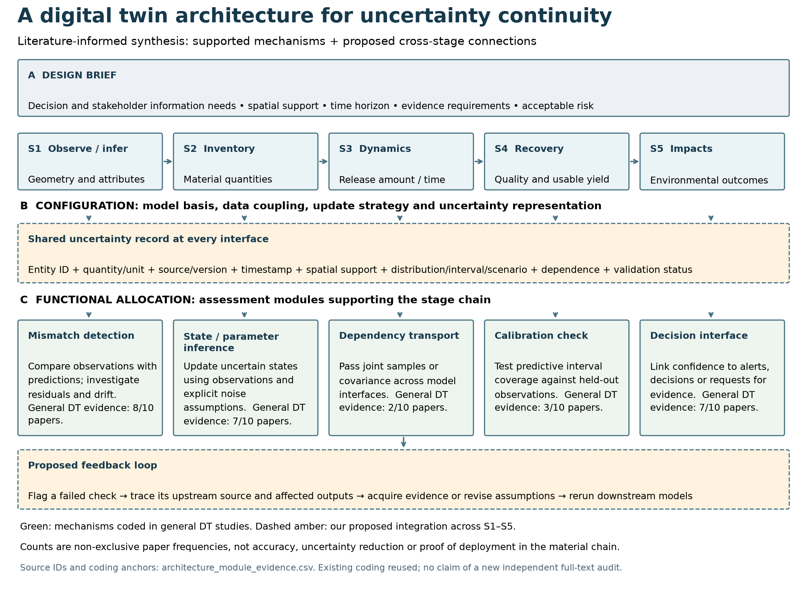
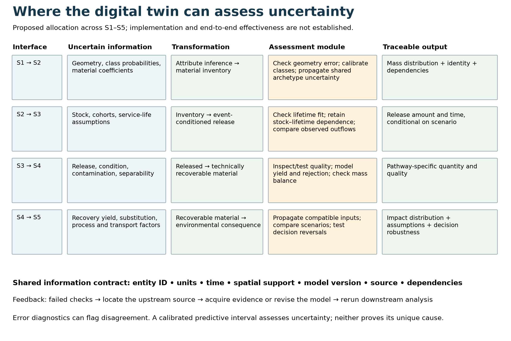
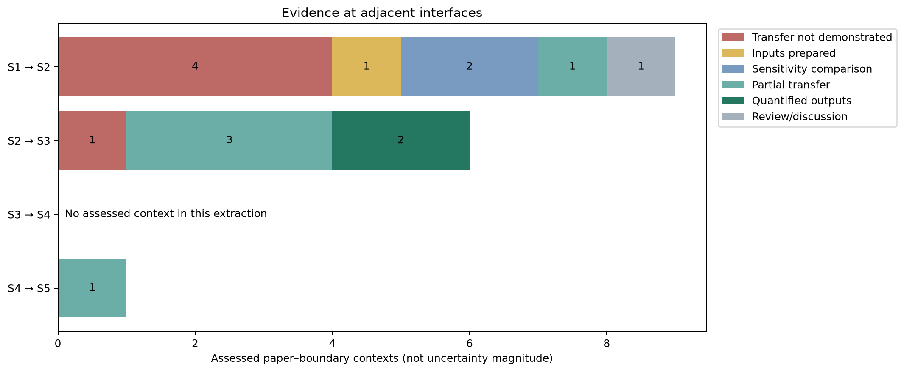

# Scientific completion review and architecture synthesis

This update advances evidence checking; it is **not a submission-ready manuscript or a closed PRISMA flow**. The previous compact PDFs remain working drafts.

## What changed

- Checked the repository tree and the principal DT definition, configuration, uncertainty-engine, material-decision and relational-analysis files. The inventory contained 1,253 entries; this is not a claim that every file was read.
- Re-ran the four relational-analysis numerical checks successfully. These verify joins/counts/source hashes, not an independent rereading of all supporting papers.
- Retried retrieval for 219 previously unassessed DT+U candidates using available cached publisher/OA locations. Three assets were returned: one new article, one incomplete book preview, and one wrong-identity article caused by an incorrect source DOI. Two eligibility decisions were subsequently completed using the correct sources.
- Corrected `DTMFU-d52dc48a0eac5845` from DOI `10.31387/oscm0640505` to `10.31387/oscm0640504`, using the [publisher issue contents](https://journal.oscm-forum.org/publication/toc/oscm-volume-19-issue-1-2026). The original DOI is preserved in `doi_correction.csv`.
- Added three figures and paper-level support for the central architecture. These distinguish existing coded mechanisms from our proposed cross-stage integration.

## Current reconciled DT+U eligibility

| Status | Publications |
|---|---:|
| Full-text candidates | 308 |
| Assessed | 91 |
| Domain included | 21 |
| Complementary included | 4 |
| Excluded from the strict triple intersection | 66 |
| Still unassessed | 217 |

The arithmetic is 91 = 21 + 4 + 66 and 308 = 91 + 217. These are this search stream's figures, **not the union of all review scenarios**. The versioned current ledger is `broad_dtu_current_fulltext_decisions.csv`; the historical eligibility ledger is preserved. Missing DOI values do not imply duplicates. The corrected non-empty DOIs in the assessed ledger are unique.

The separate Base+DT stream still has 1,676 title/abstract-retained candidates, including secondary and unclear records, without a completed consolidated full-text eligibility ledger. The focused corpus and broad corpora overlap; their included counts cannot be added.

No pending article was counted as a full-text exclusion. A failed metadata lookup or missing cached URL is not a failed full-text retrieval. The incomplete book preview remains unassessed. Consequently a final all-scenario PRISMA cannot yet be issued honestly.

## New decisions

The Yang reconstruction paper (DOI `10.1038/s41598-025-33338-3`) supplies S1 geometric-error evidence, but DT functionality is prospective. Applying the existing cross-batch criterion, it is excluded from strict S+DT+U and retained as S1 background. Its RMSE improvement does not establish calibrated uncertainty propagation. This supersedes the provisional inclusion considered during retrieval.

The Elghomri–Messaoudi review, under its corrected DOI, is retained as contextual literature and excluded from the strict intersection: its discussion of interface uncertainty does not define an extractable assessment mechanism. Its title-based deployment percentages are not imported into our evidence counts.

## Visual results

The first two diagrams are evidence-informed synthesis, not empirical flow measurements. All five assessment modules can support multiple stages; their horizontal positions do not create one-to-one S-stage assignments. `architecture_module_evidence.csv` lists 27 mechanism–paper links with DOI and coding anchors. Existing full-text appraisal coding is reused and explicitly identified as such.

The boundary figure is a calculation from the existing selected S+U extraction: 9 contexts at S1→S2, 6 at S2→S3, none at S3→S4 and 1 at S4→S5. Seven other-input→S5 contexts are not relabelled S4→S5. A context is not a unique publication. No assessed S3→S4 context is not proof that no such research exists.

## Reproduction

Python sources are in `code/`. Run from the project workspace root. The original inputs remain in `Manuscript/relational_analysis/results` and `Manuscript/methods_audit/eligibility`. Local asset paths in audit records identify files examined; publisher PDFs are not republished here.

Run `build_completion_evidence.py` first, then `consolidate_completion.py`, then `build_dt_architecture_synthesis.py`. Consolidation supersedes the initial provisional decision and produces the current ledger. `completion_status.json` preserves both the initial audit and updated reconciliation.

Remaining requirements for a final manuscript: finish broad full-text eligibility, reconcile overlapping publications across scenarios, audit positive mechanism codes against source passages/figures, regenerate the full PRISMA and manuscript from the reconciled ledgers, and inspect both language PDFs. Page-layout compliance alone does not satisfy these requirements.
