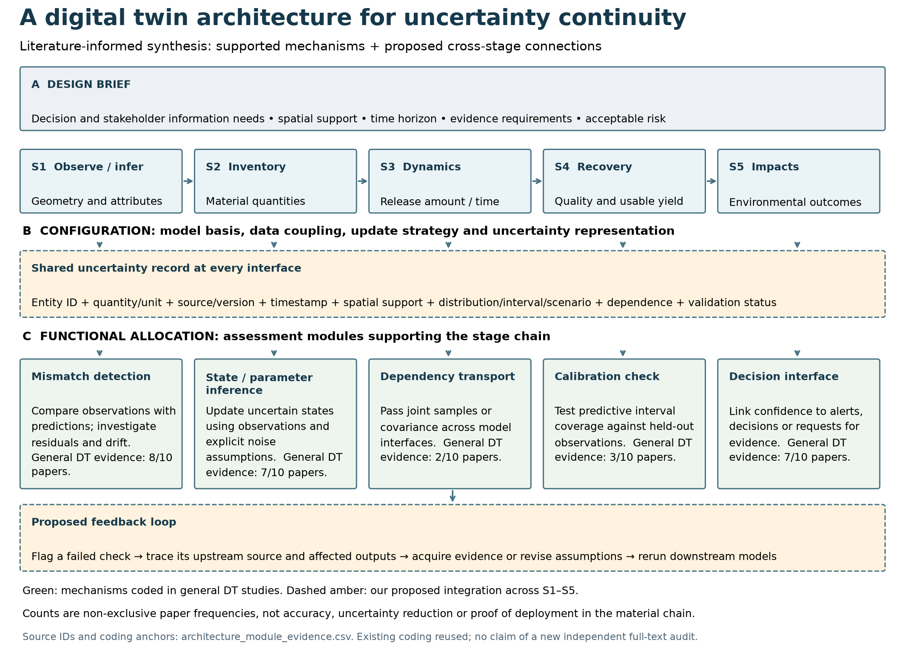
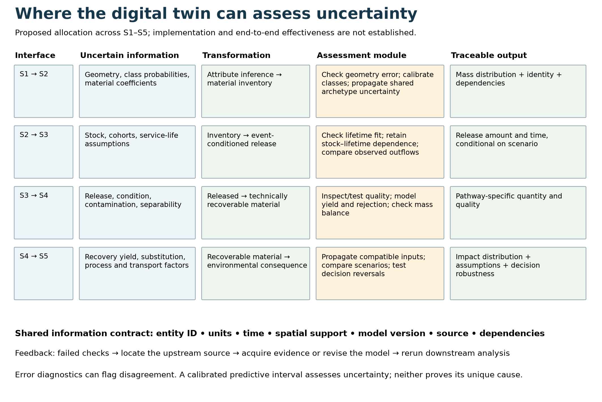
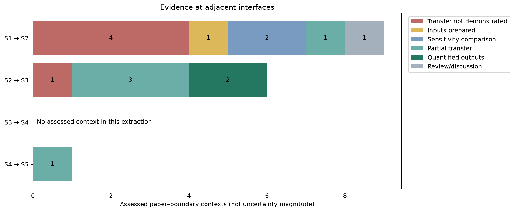

# برداشت پژوهشی و جایگاه معماری دیجیتال تویین

خروجی قابل دفاع این مجموعه، معماری‌ای است که **اطلاعات عدم قطعیت را همراه داده نگه می‌دارد و در هر تبدیل، امکان بررسی آن را فراهم می‌کند**. وجود مدل سه‌بعدی، داشبورد یا تبادل داده به‌تنهایی این قابلیت را ایجاد نمی‌کند.

در ساختار A–B–C موجود در مخزن، بخش A نیاز تصمیم، مقیاس مکانی، زمان و سطح شواهد لازم را تعیین می‌کند؛ بخش B انتخاب مدل، اتصال داده و شیوهٔ به‌روزرسانی را مشخص می‌کند؛ بخش C وظایف تشخیص، استنباط، انتقال، اعتبارسنجی و پشتیبانی تصمیم را تخصیص می‌دهد. S1–S5 مسیر تبدیل اطلاعات درون این ساختار است و با پنج لایهٔ ثابت نرم‌افزاری یکسان نیست.

پنج قابلیت در مجموعهٔ عمومی ده مقالهٔ غیرمروری DT با کد مثبت ثبت شده‌اند: تشخیص ناسازگاری در ۸ مقاله، استنباط بیزی در ۷ مقاله، انتقال صریح وابستگی‌ها در ۲ مقاله، بررسی تجربی پوشش بازه‌ها در ۳ مقاله، و اتصال اطمینان به اقدام یا هشدار در ۷ مقاله. این فراوانی‌ها هم‌پوشان‌اند؛ درصد کاهش عدم قطعیت نیستند و اجرای آن‌ها در تمام مراحل زنجیرهٔ مصالح را ثابت نمی‌کنند. شناسه و DOI هر پشتوانه در جدول همراه شکل ثبت شده است. شمارش مجدداً کنترل شده، ولی این به معنی بازخوانی مستقل همهٔ متن‌های کامل در این نوبت نیست.

برای وصل‌کردن این قابلیت‌ها، پیشنهاد ما ثبت یک بستهٔ مشترک همراه هر خروجی است: شناسهٔ موجودیت، مقدار و واحد، منشأ و نسخهٔ مدل، زمان، مقیاس مکانی، نمایش عدم قطعیت، وابستگی‌ها و وضعیت اعتبارسنجی. اهمیت این بسته در آن است که مرحلهٔ بعد بتواند تشخیص دهد دقیقاً چه چیزی را دریافت کرده و کدام فرض‌ها هنوز معتبرند.

| اتصال | آنچه تغییر می‌کند | محل ارزیابی پیشنهادی |
|---|---|---|
| S1→S2 | هندسه و طبقهٔ ساختمان به مقدار مصالح تبدیل می‌شود | خطای هندسه و طبقه‌بندی؛ وابستگی ضرایب مشترک؛ توزیع مقدار مصالح |
| S2→S3 | موجودی به مقدار و زمان آزادشدن تبدیل می‌شود | برازش عمر خدمت؛ ارتباط موجودی با عمر؛ مقایسه با خروجی مشاهده‌شده |
| S3→S4 | مصالح آزادشده به مصالح قابل‌بازیابی تبدیل می‌شود | وضعیت و آلودگی؛ بازده جداسازی؛ احتمال پذیرش کیفیت؛ موازنهٔ جرم |
| S4→S5 | مقدار و کیفیت بازیابی به پیامد محیط‌زیستی تبدیل می‌شود | جانشینی مصالح؛ عوامل فرایند و حمل؛ انتقال ورودی‌ها؛ پایداری تصمیم |

این تخصیص، تلفیق پژوهشی ماست. برای ادعای انتقال واقعی باید در همان مطالعه نشان داده شود خروجی نامطمئن بالادست با چه نمایش و چه وابستگی‌هایی وارد مدل پایین‌دست شده است. اختلاف مشاهده و پیش‌بینی می‌تواند مشکل را آشکار کند، اما منشأ آن را به‌تنهایی تعیین نمی‌کند. همچنین باریک‌شدن بازه، بدون اعتبارسنجی و مبنای مقایسهٔ سازگار، دلیل کاهش معتبر عدم قطعیت نیست.

در استخراج منتخب کنونی، ۹ زمینهٔ مقاله–مرز برای S1→S2، شش زمینه برای S2→S3 و یک زمینه برای S4→S5 ثبت شده است؛ برای S3→S4 زمینهٔ ارزیابی‌شده نداریم. این یک محدودیت مجموعهٔ استخراج‌شده است، نه اثبات نبود مطالعه در ادبیات. هفت زمینهٔ «سایر ورودی‌ها به S5» نیز نباید به اشتباه شواهد S4→S5 محسوب شوند.

بازبینی حاضر دو تصمیم متن کامل را تکمیل کرد و یک DOI اشتباه را اصلاح کرد. در جریان گستردهٔ S+DT+U اکنون ۹۱ مورد ارزیابی‌شده داریم: ۲۱ مورد دامنهٔ اصلی، چهار شاهد مکمل و ۶۶ مورد حذف از اشتراک سخت‌گیرانه. از ۳۰۸ نامزد این جریان، ۲۱۷ مورد همچنان ارزیابی نشده‌اند. جریان Base+DT نیز هنوز به تصمیم نهایی متن کامل برای تمام نامزدها نرسیده است. بنابراین این به‌روزرسانی، نسخهٔ نهایی مقاله یا PRISMA بسته‌شده نیست؛ موارد باز به صفر یا حذف ساختگی تبدیل نشده‌اند.
