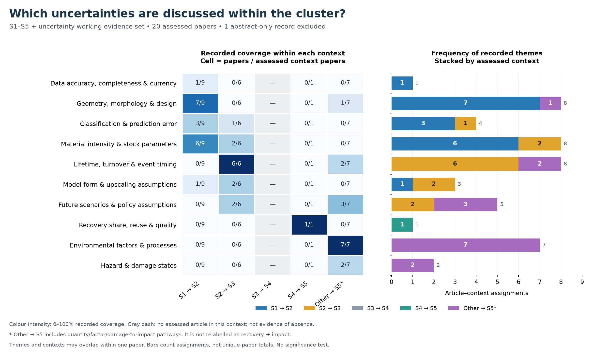

# Content profiles within the review clusters

Version: 2026-11-02. These figures describe **what the papers study**, rather than the share of records supplied by IEEE, Scopus or Web of Science. Database provenance remains in the source review datasets; it is not a thematic category.

## Completed content figures

The current figures cover the **S1–S5 + uncertainty working evidence set**. All 21 records were reconciled with the archived extraction. Twenty have recorded full-text-based assessments and enter these descriptive figures. U10 remains abstract-only and is excluded from their numerators and denominators. This is a semantic harmonization of existing extraction, **not a new reading of every full text**, independent double coding, or final PRISMA inclusion decision.

1. [Uncertainty sources](figures/01_uncertainty_sources.pdf): data quality, geometry, prediction, material parameters, timing, model/upscaling choices, scenarios, recovery, environmental factors and damage.
2. [Uncertainty methods](figures/02_uncertainty_methods.pdf): quality assessment, validation, ranges/distributions, sampling, bootstrap, sensitivity, scenarios, conditional consequences, proxy conversion and review synthesis.
3. [Continuity evidence](figures/03_continuity_evidence.pdf): whether the assessed interface has discussion, prepared inputs, sensitivity, partial transfer or quantified outputs for selected uncertain inputs.

Each figure is also supplied as editable SVG and PNG in `figures/`. [Persian interpretation and scope](REPORT_FA.md). [LaTeX figure blocks](figures.tex).



## Reading the figure correctly

- A heatmap cell is **n/N**: distinct papers with a recorded theme in that context, divided by all counted papers assessed for that context. Colour intensity is this proportion, not chi-square significance.
- Denominators: S1→S2 **9**, S2→S3 **6**, S3→S4 **0**, S4→S5 **1**, other pathways to S5 **7**. These are **23 article–context assessments from 20 unique papers**. Contexts can overlap within a paper. The denominator of one in S4→S5 must not be read as robust prevalence evidence.
- Bars count article–context assignments. Each paper can have several themes and contexts. Do not add bars to estimate unique papers or add cluster totals across overlapping searches.
- A zero means the theme was **not recorded in the extraction for the assessed context**, not that the paper or the wider literature proves its absence. The grey S3→S4 column has no assessed article; its percentages are undefined, not zero.
- “Other → S5” keeps quantity/factor-to-impact and damage-to-impact pathways separate from recovery→impact. It includes two complementary damage papers and a methodological review.
- Sources, methods and continuity states are separate dimensions. Monte Carlo is a method; it is not a type or source of uncertainty. A local uncertainty calculation is not automatically uncertainty transfer across an interface.
- Epistemic/aleatory classification is **not consistently extracted in these source tables**. No frequency of those types is inferred from method names. A probability distribution alone is insufficient to decide that taxonomy.
- The 20 counted papers comprise 16 primary topic studies, two methodological/review records (U02, U14), and two complementary primary studies (U20, U21). These roles are retained as columns for alternative subsets.

## Traceable coding and reproducibility

`codebook.csv` defines descriptive categories. `article_context_assessments.csv` stores every assessment, its DOI, reason, original evidence class, page/section anchor when available and prior review basis. `positive_theme_assignments.csv` contains the positive tags, while `complete_coding_matrix.csv` also retains `not_recorded_in_extraction` entries. A negative inference must not be made from the latter status.

`theme_context_counts.csv` and `continuity_counts.csv` list the paper IDs behind every count. The builder contains explicit semantic decisions and does not screen records using keywords. Original source tables and the revised U06 note are preserved under `inputs/`, with SHA-256 fingerprints in `validation.json`.

Inputs originate in [`analysis_ready/seleted papers S1-S5 + U`](../../analysis_ready/seleted%20papers%20S1-S5%20%2B%20U). Existing broad search records and temporal counts have not been recoded or overwritten. PDFs are not redistributed here.

U06 illustrates why context-specific coding matters: its emission-factor sampling is assigned to other→S5, rather than every upstream interface. The newer main-text/SI note reports reduction of building-event probabilities to selected event years; the S2→S3 row is therefore coded **N**, while its S1→S2 MI-range transformation and downstream factor-to-impact assessment remain **P**. This is an explicit boundary-level refinement of the older article-wide `mixed_partial` label, not a silent replacement.

Reproduce with Python 3 and matplotlib/numpy:

```text
python code/build_content_profiles.py
```

The script checks DOI uniqueness, coverage of all 21 IDs, excluded-record handling, context denominators, duplicate article–context assignments and reconciliation of continuity categories. Figure layouts were visually inspected. There is no chi-square test: these selected, partly overlapping, multilabel counts with sparse cells are presented descriptively. Any inferential comparison would require a separately justified unit of analysis, independence/dependence model and adequate observations.

## Extension to the other clusters

The table below defines the **proposed content dimensions** for subsequent coding. It does not claim completed counts or observed prevalence in those clusters. Existing full-text extractions can be harmonized to these dimensions; title/abstract records must retain a different evidence tier. Search membership alone is not content coding, and these six retrieval streams are not assumed to be disjoint or perfectly nested.

| Cluster | Content to extract within the cluster | Comparison axis | Current output here |
|---|---|---|---|
| S1–S5 | Data sources, represented material quantities, transformation models, outputs and interfaces | Stage and assessed transition | Proposed coding dimensions only |
| S1–S5 + U | Uncertainty sources, representation, methods, dependence and continuity/gaps | Assessed transition | Three descriptive figures for the reconciled 21-record working set; 20 counted |
| S1–S5 + DT | Implemented observation, inventory, temporal updating, recovery-routing and impact modules; actual interfaces | Material-flow function and stage | Proposed dimensions; no new frequency counts |
| S1–S5 + U + DT | Which module represents U; what U payload crosses which interface; update/decision mechanisms | DT component × material-flow transition | Proposed dimensions; no new frequency counts |
| DT | Data acquisition, model coupling, updating, services, provenance and governance | Architectural function; application domain as a separate label | Proposed dimensions; no new frequency counts |
| DT + U | State/parameter estimation, model discrepancy, probabilistic propagation, residual/drift monitoring, calibration and U-aware decisions | Mechanism × architectural function | Proposed dimensions; no new frequency counts |

Spatial scale, temporal resolution/update mode and stakeholder information needs should be **cross-cutting coded attributes**, where reported. Do not create a separate case-specific stakeholder list in place of architectural functions. Do not infer that a generic DT method is implemented in material-flow stages without a domain bridge.

For each eventual component diagram, preserve the distinction between (a) explicitly described or implemented in a source, (b) synthesized across sources, and (c) proposed to address a documented gap. The component frequencies alone cannot validate the synthesized architecture.
