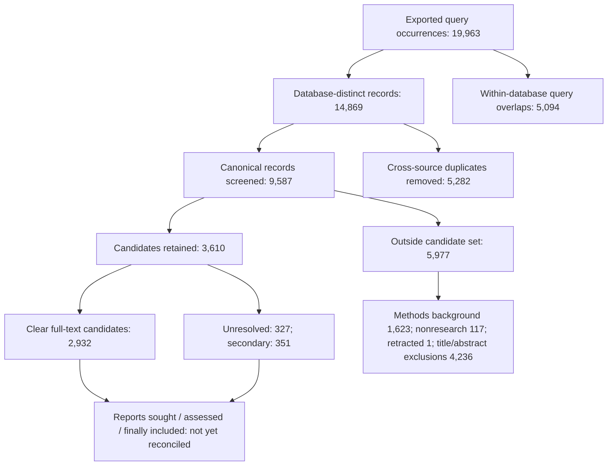
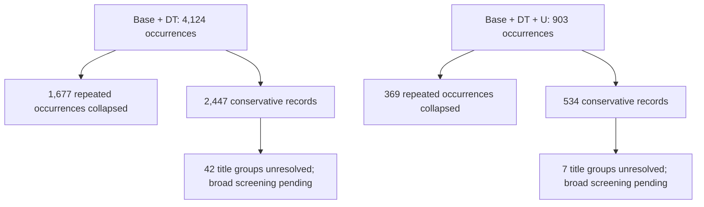
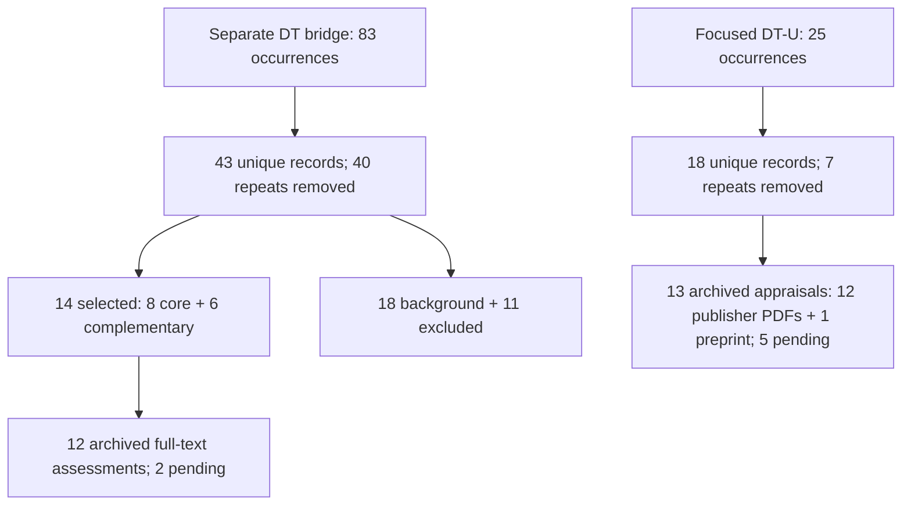

# Methods draft and flow audit — 2 November 2026

This is an auditable draft, not a completed final PRISMA flow. A missing count is not zero. Search families overlap and were not all derived from an identical Base query.

## Documented counts and sources

| Collection | Occurrences | Conservative/adjudicated records | Assessment status |
|---|---:|---:|---|
| S4–S5 Base/U combined | 19,963 | 9,587 after adjudication | Title/abstract decisions complete; full-text eligibility incomplete |
| S1–S5 Base + DT | 4,124 | 2,447 conservative | Broad screening incomplete; 42 title groups unresolved |
| S1–S5 Base + DT + U | 903 | 534 conservative | Broad screening incomplete; 7 title groups unresolved |
| Separate DT bridge search | 83 | 43 | 14 selected for full-text work; 12 archived assessments; 2 pending |
| Separate focused DT–U search | 25 | 18 | 13 archived assessments; 5 pending |

S1–S3 legacy Base/U counts cannot yet be presented as an end-to-end PRISMA flow. The broad Base+U figures are not the 392-record focused S4–S5 mechanism subset. No global total is calculated by summing these families.

Sources: `S4 S5 Core Review/screening/adjudication/unclear946_recheck/PRISMA_RECHECK.md` and `prisma_counts.csv`; `Digital Twin Material Flow Review/analysis/summary.json`; its `uncertainty_stage_searches_2026-11-02/analysis/summary.json`; `bridge_searches/analysis/summary.json` and `bridge_searches/fulltext_review/summary.json`; `Digital Twin Uncertainty Review/analysis/mechanism_focus/audit.json` and `fulltext/review_audit.json`; `Manuscript/relational_analysis/paper_registry.csv` and README. Paths refer to the local outputs tree and corresponding archived review sources, not a new retrieval.

## S4–S5 Base/U combined: PRISMA-compatible audit snapshot

These retained counts are not a claim that 3,610 retrieval attempts occurred. The 392 uncertainty-query clear candidates are part of the 2,932, not an additional corpus.

## Broad DT families: identification only

## Focused searches and working appraisals

The S–U working collection separately contains 21 records / 20 archived appraisals. Combined with 14 S–DT and 18 DT–U records, the registry has 53 memberships, 52 distinct records and 44 distinct archived full-text appraisals. Final inclusion and independent study-family counts remain unestablished.

PRISMA reporting reference: Page et al. (2021), https://doi.org/10.1136/bmj.n71; official templates: https://www.prisma-statement.org/prisma-2020-flow-diagram. These diagrams adapt the reporting logic but are progress snapshots, not completed PRISMA templates.

## Graphic outputs
Six PRISMA-style progress figures are provided in `figures/` as PNG, SVG and PDF, with `PRISMA_progress_atlas.pdf` combining all six. They are adapted progress views, not final inclusion diagrams. `methods_before_readability_revision.tex` preserves prior screening provenance. Search dates and actual screening arrangements were removed from the current prose at the author's request, not changed in the audit history; final reporting still needs complete methodological disclosure.
