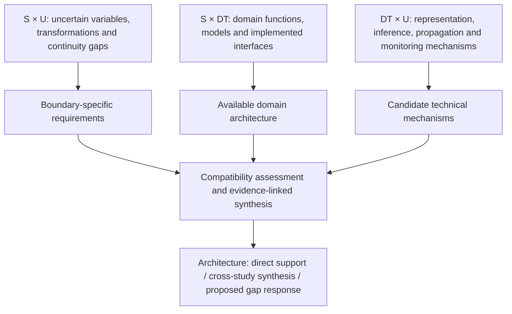

# Relational synthesis: stages, uncertainty and Digital Twin capabilities

Date: 2026-11-02. This extends the earlier `content_profiles/` work from uncertainty themes to **three connected evidence relations**. The aim is an architecture grounded in literature, not a collection of unrelated frequency charts.

Read [the analysis protocol in Persian](ANALYSIS_PROTOCOL_FA.md), [the reference-method audit](REFERENCE_METHOD_AUDIT.md), [the data schema](evidence_schema.json) and [the initial synthesis paths](synthesis_paths.csv).

**Data-derived diagrams:** [four-page atlas and reproducible calculations](data_diagrams/README.md). It contains a boundary/status alluvial, a weighted stage/function network, exact uncertainty-mechanism intersections and a source/method association map. Every edge and configuration has supporting record IDs and DOIs.

The [earlier descriptive matrices](results/README.md) remain available in a revised four-page atlas. The former architecture Figures 05–06 are now separated into [conceptual synthesis](conceptual_synthesis/README.md) and are excluded from both data-result atlases. They are proposals, not data-discovered interfaces.

Conceptual logic of the review (not an empirical network):



S1–S5 denote material-flow functions: attribute acquisition/inference; material inventory; temporal stock/outflow dynamics; recovery/reuse/circular routing; environmental assessment. They are not the five DT categories in the reference article.

## Work completed in this update

- Examined the supplied reference's analysis pipeline and key figures and separated its actual analyses from our adaptations.
- Reconciled all entries in the three existing working extraction tables into a DOI-linked registry, retaining membership in multiple streams and unresolved access statuses.
- Defined three matrices, co-occurrence and coupling analyses, component-level temporal analysis, contextual attributes and evidence-to-architecture synthesis.
- Added four explicit synthesis paths, one per material-flow boundary. These are reviewer syntheses/proposals with identified evidence and missing links, **not newly validated DT implementations**.

`paper_registry.csv` contains **52 distinct records after exact DOI matching**, drawn from **53 stream memberships**. One record has no established DOI and is retained by source identity. The tables record **44 distinct records with an archived full-text-based assessment**. These are working evidence inputs, not final PRISMA inclusions or independent primary experiments.

| Working input stream | Records | Archived full-text-based assessments | Pending / abstract-only | Scope limitation |
|---|---:|---:|---:|---|
| S–U | 21 | 20 | 1 | Selected uncertainty-continuity working set, including reviews and complements |
| S–DT | 14 | 12 | 2 | Focused S1→S2 / S2→S3 bridge set, including enabling methods and complements; not complete S1–S5 DT coverage |
| DT–U | 18 | 13 | 5 | Includes 12 publisher-PDF appraisals and one preprint-version appraisal; mixes primary mechanisms, reviews and adjacent systems |

The shared DOI 10.1016/j.jobe.2025.113391 remains in S–U and S–DT but has one registry ID. No fuzzy title merges, guessed DOI values or new eligibility decisions are introduced. The reference paper is not silently added to these counts.

## What is not claimed

The register is complete for these three source tables. **Three scoped descriptive matrices and an exploratory DT–U co-occurrence analysis are now completed in `results/`.** They use semantic coding of archived appraisals, not raw retrieval counts. Broader full-text interface extraction, component-level temporal analysis, formal inference and architecture validation remain uncompleted. A new full-text review, access recovery, study-family audit or expert survey was not conducted in this update. Pending records remain excluded from the content counts.

The script rebuilds the registry and readiness audit from the original extraction tables and checks coverage, uniqueness and source hashes:

```text
python code/audit_evidence_inputs.py
```

Run inside the existing repository, where the original datasets are under `analysis_ready/`, or in the local output tree. `validation.json` records the audit. Scientific classifications and synthesis paths are review decisions, not results generated from word matching.
