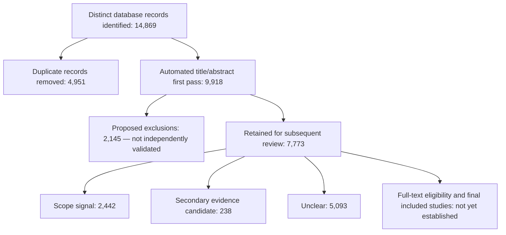

# S4–S5 title/abstract screening and PRISMA accounting

**Status: complete automated first pass over every record; provisional decisions, not final eligibility.** This is a real full-corpus output, not a sampled export. No independent human screening or S4/S5 full-text eligibility assessment is claimed. The separate 12 Digital Twin fulltexts are not counted in this flow.

## Counts

| Step | Records |
|---|---:|
| Exported search/query occurrences | 19,963 |
| Repeated query memberships, removed before identification accounting | 5,094 |
| Distinct records within databases: Scopus / WoS / IEEE | 8,248 / 5,994 / 627 |
| Records identified across databases, before cross-source deduplication | 14,869 |
| Duplicate records removed before screening | 4,951 |
| Records processed by automated title/abstract rules | 9,918 |
| Proposed automated exclusions, requiring validation | 2,145 |
| Retained with explicit scope signals | 2,442 |
| Retained as secondary-evidence candidates | 238 |
| Retained as unclear | 5,093 |
| Total retained for subsequent review | 7,773 |

34 additional duplicates were resolved beyond the previous 9,952-record dataset: normalized specific title (at least eight words), year, full author-list and source must match, with no contradictory DOI. Every alias is logged. **330 residual title/year candidate groups remain unmerged** because they require adjudication. No DOI is invented or inferred from title similarity alone.

This is an **interim PRISMA-aligned accounting diagram**, not a claim that the systematic review is complete. PRISMA specifies transparent reporting of selection methods, reviewer involvement, automation and exclusions; it does not itself supply this project's eligibility rules or validate an automated classifier. See the [PRISMA 2020 checklist](https://www.prisma-statement.org/prisma-2020-checklist) and [selection-process guidance](https://www.bmj.com/content/372/bmj.n160).

## Scope and decision rules

- S4: building-material recovery, reuse, recycling, deconstruction, circularity and associated stock/flow outputs.
- S5: embodied impacts or construction-material-related life-cycle/environmental assessment and resulting decisions.
- Digital Twin, an uncertainty keyword, a particular year, language or publication type is **not** mandatory for inclusion.
- Operational energy, communications/software, clinical topics and seismic risk can generate noise. A proposed automated exclusion requires positive evidence of one of these topics in the title/abstract and no protective material, embodied-impact or whole-life signal in title, abstract or keywords. Missing/short abstracts remain unclear.
- Keywords may protect against exclusion but cannot establish an inclusion signal. A keyword hit is not proof of study eligibility.
- Heritage retention, service-life extension, material terminology and LCA signals protect potentially relevant records. A clinical term in a healthcare-building study is insufficient: a clinical-topic signal in its title is also required.
- All ambiguous records remain available for further review. Review articles can be secondary evidence; they are not silently treated as primary studies.

Rules are deliberately conservative but can still misclassify papers or miss synonyms and translations. The 2,145 proposed exclusions must not be treated as validated final removals or as a measured false-positive rate. `retained_for_review.zip` is a working review queue, **not a final included-study dataset**. No originals were deleted and no files were written to the prior project's `final_screened` area.

## Continuity with S1–S3 and audit

The prior `analysis_ready/noise_precision_diagnostic` applies flags for prioritization, not automatic final exclusion. Its multistage screening was a provisional pilot. This extension keeps that distinction: proposed machine decisions are explicit and reversible. The rules were developed and revised during this run; they are **not preregistered**.

The assistant read the full supplied abstracts of 39 records for a rule audit (12 software/location/monitoring, 15 operational-energy, 12 seismic-risk examples). This was a single-assistant development check, not independent validation, not human review, and not a precision/recall estimate. Additional healthcare examples revealed overbroad patient-word matching; the rule was narrowed. Heritage-retention ambiguity and indexed-keyword false positives were also addressed. Per-record audit notes are provided. No Wilson interval or general classifier accuracy is reported.

## Files and metadata

- `tables/all_records_screening.zip`: full CSV for all 9,918 records, including proposed exclusions.
- `tables/retained_for_review.zip`, `automated_exclusions.zip`, `unclear_requires_review.zip`: lossless CSV subsets with the same columns.
- `tables/screening_index.csv`: browsable index; only the long abstract column is omitted here. The full abstract remains in the ZIP CSVs.
- `tables/duplicate_resolution.csv` and `residual_duplicate_candidates.csv`: resolved aliases and unresolved candidates.
- `tables/assistant_abstract_audit.csv`: explicit, limited assistant audit.
- `tables/prisma_counts.csv`, `stage_counts.csv`, `metadata_completeness.csv`, `file_manifest.csv`: accounting and quality controls.
- `tables/digital_twin_followup.csv`: all Digital Twin mentions, including out-of-scope or unclear records; a later-work queue, not a DT architecture synthesis.
- `rules.json`, `code/screen_records.py`, `code/report_screening.py`: executable rules and reproducible reporting.

Full CSVs retain DOI where supplied, title, authors, year, venue, abstract, author/index keywords, affiliations, volume, issue, pages/article number, publisher, ISSN/ISBN, language, open-access/license indicators and database provenance. Conflicting database values are retained as alternatives separated by ` | `, not silently reconciled. DOI blanks remain explicit. Original funding, references and other native fields remain in the unchanged parent raw archives, linked through source filenames and native identifiers. Scopus S5 reference-list export limitations still apply.

## Rebuild

Extract the parent raw archives as documented in the parent README; extract the parent full tables into its `final` directory. Run `python screening/code/screen_records.py`, then `python screening/code/report_screening.py` from any directory. Python standard library only. CSVs use UTF-8 with BOM and ZIP compression is lossless. Raw files are read only. Full CSV subsets are streamed directly to ZIP to avoid excessive temporary disk use.

The next substantive review step is adjudication of residual duplicates and unclear/proposed-exclusion records, followed by full-text eligibility and evidence-anchored uncertainty-transfer extraction. Current scope signals do not demonstrate uncertainty propagation, transformation or a Digital Twin architecture.
